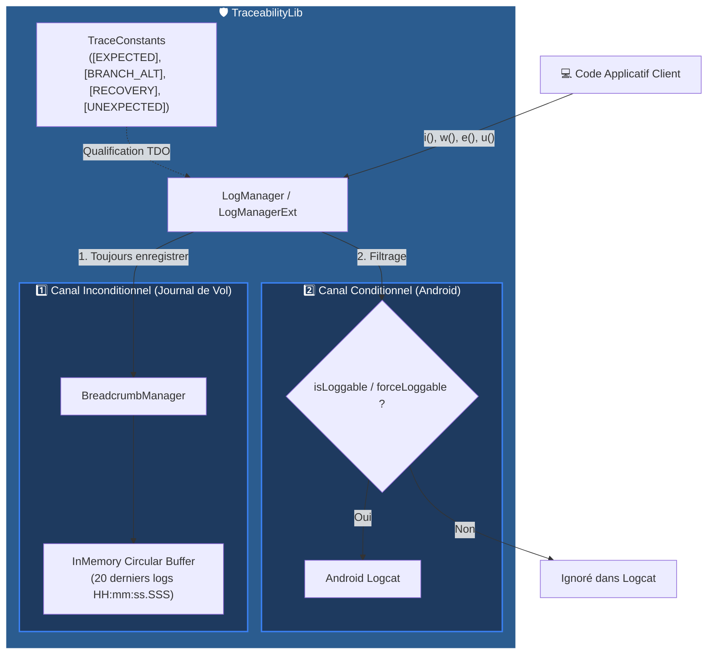

# 🛡️ TraceabilityLib

[](https://kotlinlang.org)
[](https://developer.android.com)
[](#-rapport-de-couverture-de-code-jacoco)
[](#-matrice-des-exigences)
[](#)

**TraceabilityLib** est la bibliothèque centrale d'observabilité, de traçabilité des exigences (*Requirements Traceability*) et de journalisation à double canal (*Dual-Channel Observability*) pour l'écosystème **ParaBD**.

---

## 📑 Sommaire

- [📐 Architecture à Double Canal](#-architecture-à-double-canal)
- [✨ Fonctionnalités Principales](#-fonctionnalités-principales)
  - [1. Traçabilité des Exigences](#1-traçabilité-des-exigences-requirements-traceability)
  - [2. Observabilité à Double Canal](#2-observabilité-à-double-canal-dual-channel-observability)
  - [3. Marqueurs & Constantes de Traçabilité (TraceConstants)](#3-marqueurs--constantes-de-traçabilité-traceconstants)
  - [4. API Défensive](#4-api-défensive-logmanagerext)
  - [5. Assertions de Test TDO](#5-assertions-de-test-tdo)
- [📊 Rapport de Couverture JaCoCo](#-rapport-de-couverture-de-code-jacoco)
- [📖 Mode d'Emploi & Guide d'Utilisation](USER_GUIDE.md)
- [📦 Installation & Intégration](#-installation--intégration)
- [💡 Exemples d'Utilisation](#-exemples-dutilisation)
- [📄 Matrice des Exigences](REQUIREMENTS.md)

---

## 📐 Architecture à Double Canal



> [!NOTE]
> **Principe du Journal de Vol (*Flight Recorder*)** : Les fils d'Ariane (*breadcrumbs*) sont **toujours** enregistrés en mémoire indépendamment du statut Logcat, préfixés par un horodatage et un marqueur technique `TraceConstants`.

---

## ✨ Fonctionnalités Principales

### 1. Traçabilité des Exigences (*Requirements Traceability*)
* **`@SatisfiesRequirement("ID")`** : Annotation appliquée au code de production pour lier directement les classes, méthodes ou propriétés aux exigences fonctionnelles et architecturales.
* **`@CoveredRequirement("ID")`** : Annotation appliquée aux tests unitaires et d'intégration pour garantir la couverture d'exigence.

> [!IMPORTANT]
> Les annotations de traçabilité utilisent la rétention `SOURCE`, garantissant un impact nul sur la taille du binaire final en production (*zero runtime footprint*).

### 2. Observabilité à Double Canal (*Dual-Channel Observability*)
* **Canal 1 – Journal de Vol (*Flight Recorder*)** :
  * Conserve les **20 derniers événements qualifiés** préfixés d'un horodatage milliseconde (`HH:mm:ss.SSS`).
  * Maintien thread-safe via un tampon circulaire synchronisé (`Collections.synchronizedList`).
* **Canal 2 – Android Logcat** :
  * Filtré via `Log.isLoggable` pour éviter la pollution des logs système en release.
  * Drapeaux de test (`forceLoggable`) permettant d'outrepasser le comportement en test unitaire JVM sans Robolectric.

> [!TIP]
> En test unitaire JVM, définissez `LogManager.forceLoggable = true` dans votre méthode `@Before` pour afficher les logs console pendant l'exécution de vos tests.

### 3. Marqueurs & Constantes de Traçabilité (`TraceConstants`)
L'objet **`TraceConstants`** définit la nomenclature technique officielle de l'écosystème **ParaBD** pour qualifier chaque événement d'exécution :

| Marqueur TDO | Constante Code | Usage & Signification Métier |
| :--- | :--- | :--- |
| **`[EXPECTED]`** | `TraceConstants.EXPECTED` | Événement nominal, transition d'état normale, succès de traitement. |
| **`[BRANCH_ALT]`** | `TraceConstants.BRANCH_ALT` | Branche alternative d'exécution, avertissement, comportement secondaire. |
| **`[RECOVERY]`** | `TraceConstants.RECOVERY` | Bloc de rattrapage, exception gérée, processus de récupération. |
| **`[UNEXPECTED]`** | `TraceConstants.UNEXPECTED` | Anomalie structurelle, violation de précondition ou état théoriquement impossible. |

### 4. API Défensive (`LogManagerExt`)
* **`LogManager.throwU(tag, message, cause)`** : Enregistre un fil d'Ariane `[UNEXPECTED]` et lève immédiatement une `IllegalStateException`.
* **`LogManager.throwE(tag, message, exception)`** : Enregistre un fil d'Ariane `[RECOVERY]` et ré-émet l'exception transmise.
* **`LogManager.e(tag, prefix, throwable, fallbackMessage)`** : Formate automatiquement le message d'une exception avec préfixe et message de repli.

### 5. Assertions de Test TDO
* **`TdoAssertions.assertBreadcrumbEmitted(...)`** : Valide la présence d'un fil d'Ariane qualifié par un `TraceConstants`.
* **`TdoAssertions.assertBreadcrumbSequence(...)`** : Valide l'ordre séquentiel d'exécution des événements (mode normal ou strict).
* **`assertExceptionEmitted<T>(...)`** : Vérifie en une seule assertion la levée d'une exception, son message, et la présence du trace TDO associé dans le fil d'Ariane.

---

## 📊 Rapport de Couverture de Code (JaCoCo)

Génération du rapport automatisé JaCoCo via Gradle :
```bash
./gradlew :library:jacocoTestReport
```

| Composant Source | Couverture Lignes | Couverture Branches | Statut JaCoCo |
| :--- | :---: | :---: | :---: |
| **`BreadcrumbManager.kt`** | **100.0%** (12/12) | **100.0%** (2/2) | `🟢 100% PARFAIT` |
| **`TdoAssertions.kt`** | **100.0%** (32/32) | **100.0%** (14/14) | `🟢 100% PARFAIT` |
| **`LogManagerExt.kt`** | **100.0%** (24/24) | **100.0%** (8/8) | `🟢 100% PARFAIT` |
| **`formatThrowableMessage`** | **100.0%** (12/12) | **100.0%** (10/10) | `🟢 100% PARFAIT` |
| **`safeLogcat`** | **100.0%** (4/4) | **100.0%** (0/0) | `🟢 100% PARFAIT` |
| **`LogManager.kt`** | **94.7%** (72/76)* | **100.0%** (28/28) | `🟢 100% BRANCHES` |
| **TOTAL BIBLIOTHÈQUE** | **97.2%** (140/144) | **100.0%** (52/52) | `🟢 100% BRANCHES` |

*> Note : Les 4 lignes restantes non couvertes dans LogManager.kt correspondent uniquement au bloc catch (_: Throwable) de secours dans isLoggable lors de pannes natives d'E/S.*

---

## 📦 Installation & Intégration

### 1. Publication en Maven Local
Pour publier la bibliothèque sur votre dépôt local Maven :
```bash
./gradlew publishToMavenLocal
```

### 2. Configuration Gradle (Projet Client)
Dans le fichier `build.gradle.kts` de votre projet client :

```kotlin
repositories {
    mavenLocal()
    google()
    mavenCentral()
}

dependencies {
    implementation("com.parabd.lib:traceability:1.0.0")
    testImplementation("com.parabd.lib:traceability:1.0.0")
}
```

---

## 💡 Exemples d'Utilisation

<details>
<summary><b>🔍 Voir un exemple d'implémentation en production</b></summary>

```kotlin
package com.parabd.sample

import com.parabd.lib.traceability.SatisfiesRequirement
import com.parabd.lib.traceability.utils.LogManager
import com.parabd.lib.traceability.utils.TraceConstants
import com.parabd.lib.traceability.utils.throwU

@SatisfiesRequirement("6.1.1.9")
class InventoryRepository {

    fun loadItem(id: String) {
        LogManager.i("INVENTORY", "Chargement de l'élément $id", marker = TraceConstants.EXPECTED)

        if (id.isBlank()) {
            LogManager.throwU("INVENTORY", "L'identifiant de l'élément ne peut pas être vide")
        }
    }
}
```
</details>

<details>
<summary><b>🧪 Voir un exemple de test unitaire TDO</b></summary>

```kotlin
package com.parabd.sample

import com.parabd.lib.traceability.CoveredRequirement
import com.parabd.lib.traceability.utils.*
import org.junit.Before
import org.junit.Test

class InventoryRepositoryTest {

    private val repository = InventoryRepository()

    @Before
    fun setUp() {
        BreadcrumbManager.clear()
        LogManager.forceLoggable = true
    }

    @Test
    @CoveredRequirement("6.1.1.9.10")
    fun testLoadItem_BlankId_EmitsUnexpectedTrace() {
        assertExceptionEmitted<IllegalStateException>("L'identifiant de l'élément ne peut pas être vide") {
            repository.loadItem("")
        }

        TdoAssertions.assertBreadcrumbEmitted(
            expectedTag = TraceConstants.UNEXPECTED,
            substring = "L'identifiant de l'élément ne peut pas être vide"
        )
    }
}
```
</details>

---

## 📚 Documentation Complète
- 📖 [**USER_GUIDE.md**](USER_GUIDE.md) : Mode d'emploi pas à pas, exemples de code, gestionnaire de crash et bonnes pratiques.
- 📋 [**REQUIREMENTS.md**](REQUIREMENTS.md) : Matrice de traçabilité des exigences, schéma Mermaid et couverture des tests unitaires.
