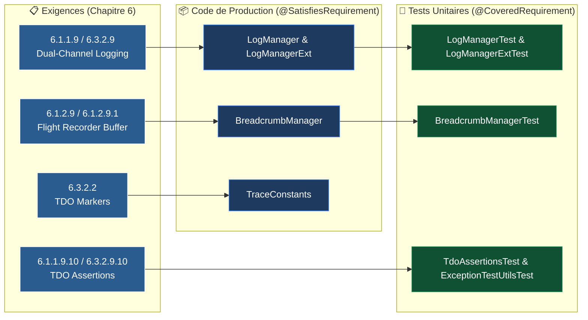

# 📋 Matrice des Exigences & Traçabilité - TraceabilityLib

Ce document répertorie les exigences fonctionnelles et architecturales satisfaites par le code de production et vérifiées par la suite de tests unitaires de **TraceabilityLib**.

---

## 🔗 Liens Rapides
- 🛡️ [**README.md**](README.md) : Présentation générale et diagramme d'architecture.
- 📖 [**USER_GUIDE.md**](USER_GUIDE.md) : Mode d'emploi pas à pas, exemples de code et tests unitaires/instrumentés.

---

## 🌐 Schéma de Traçabilité Exigence ➔ Implémentation ➔ Test

---

## 📊 Tableau Détaillé des Exigences

| ID Exigence | Composant Implémenté | Description Fonctionnelle / Architecturale | Statut de Couverture |
| :--- | :--- | :--- | :---: |
| **`6.1.1.9`** | `LogManager`, `LogManagerExt` | **API d'Observabilité Centralisée à Double Canal** : Émission inconditionnelle des breadcrumbs pour le journal de vol + filtrage Logcat conditionnel via `Log.isLoggable`. | `✅ PASS` |
| **`6.1.2.9`** | `BreadcrumbManager` | **Tampon Circulaire In-Memory (Flight Recorder)** : Stockage thread-safe des $N$ derniers événements qualifiés avec horodatage (`HH:mm:ss.SSS`). | `✅ PASS` |
| **`6.1.2.9.1`**| `BreadcrumbManager` | **Rotation & Purge du Tampon** : Rotation automatique (maintien des 20 derniers logs) et méthode de purge `clear()` pour les tests. | `✅ PASS` |
| **`6.3.2.2`** | `TraceConstants` | **Nomenclature Technique TDO** : Définition des constantes de marqueurs d'exécution (`[EXPECTED]`, `[BRANCH_ALT]`, `[RECOVERY]`, `[UNEXPECTED]`). | `✅ PASS` |
| **`6.3.2.9`** | `LogManager`, `LogManagerExt`, `TdoAssertions` | **API de Journalisation Défensive & Contrôle de Séquence** : Extensions `throwU`, `throwE`, `e` avec repli et assertions d'observabilité. | `✅ PASS` |
| **`6.1.1.9.10`**| `TdoAssertions`, `ExceptionTestUtils` | **Assertions TDO pour Tests Unitaires** : Vérification unifiée de la présence des fils d'Ariane et des séquences d'exécution. | `✅ PASS` |
| **`6.3.2.9.10`**| `TdoAssertions`, `ExceptionTestUtils` | **Observabilité des Exceptions** : Vérification combinée type/message d'exception + trace d'observabilité dans le journal de vol. | `✅ PASS` |

---

## 🏷️ Annotations de Traçabilité

> [!NOTE]
> Les annotations ci-dessous permettent le chaînage automatique entre le cahier des charges, l'architecture et la suite de tests automatisés.

### `@SatisfiesRequirement(id: String)`
Renseigne l'exigence fonctionnelle ou architecturale satisfaite par un élément de code de production.
* **Cibles** : `CLASS`, `FUNCTION`, `PROPERTY`, `CONSTRUCTOR`
* **Rétention** : `SOURCE`

### `@CoveredRequirement(id: String)`
Renseigne l'exigence fonctionnelle vérifiée et couverte par une suite de tests unitaires ou d'intégration.
* **Cibles** : `CLASS`, `FUNCTION`, `PROPERTY`, `CONSTRUCTOR`
* **Rétention** : `SOURCE`

---

## 🧪 Suites de Tests Unitaires Associées

| Classe de Test | Exigences Couvertes | Nombre de Tests | Description de la Couverture |
| :--- | :--- | :---: | :--- |
| **`BreadcrumbManagerTest`** | `6.1.2.9.1` | 3 | Valide le stockage, la rotation du tampon circulaire (max 20) et la réinitialisation `clear()`. |
| **`LogManagerTest`** | `6.1.1.9.10`, `6.3.2.9.10` | 6 | Valide l'émission inconditionnelle des breadcrumbs et le contrôle par flag `forceLoggable`. |
| **`LogManagerExtTest`** | `6.1.1.9.10`, `6.3.2.9.10` | 5 | Valide les extensions `throwU`, `throwE` et `e` avec préfixe/repli. |
| **`TdoAssertionsTest`** | `6.1.1.9.10`, `6.3.2.9.10` | 3 | Valide les assertions d'émission de breadcrumbs et le contrôle de séquence séquentielle. |
| **`ExceptionTestUtilsTest`** | `6.1.1.9.10`, `6.3.2.9.10` | 5 | Valide la vérification unifiée type exception + message + trace TDO d'observabilité. |
